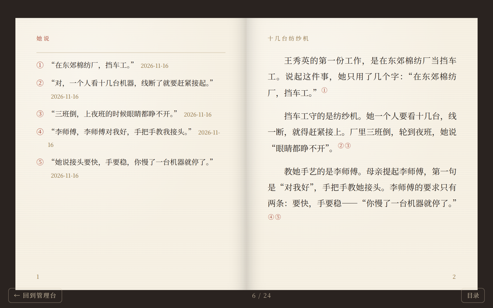
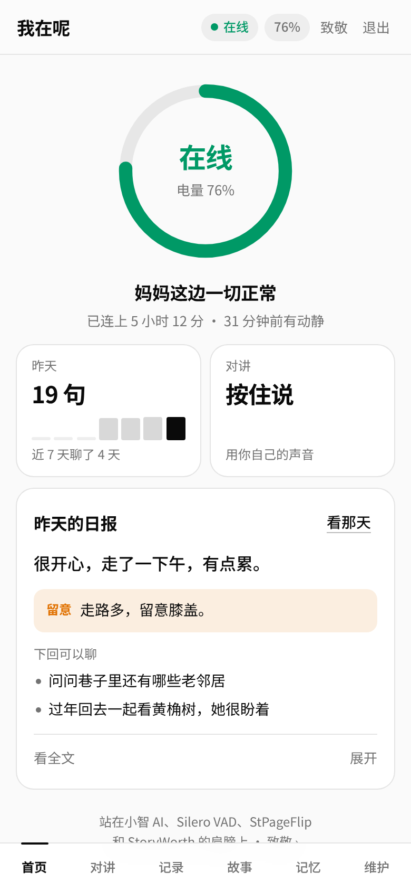
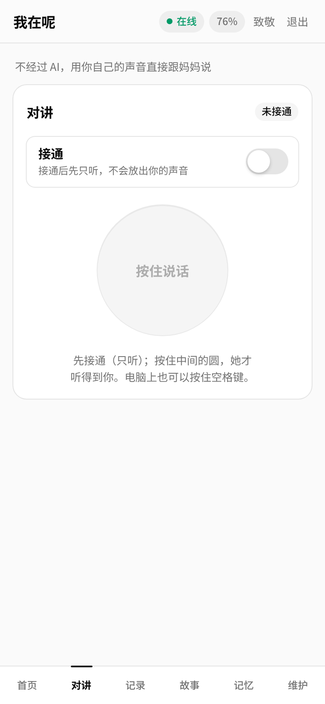
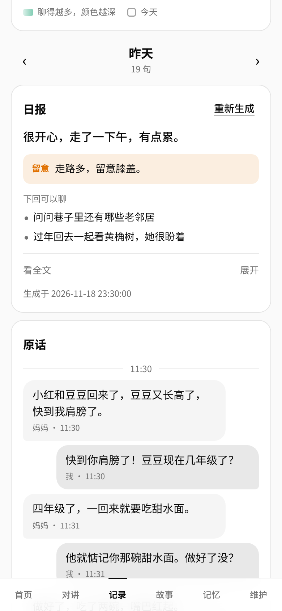
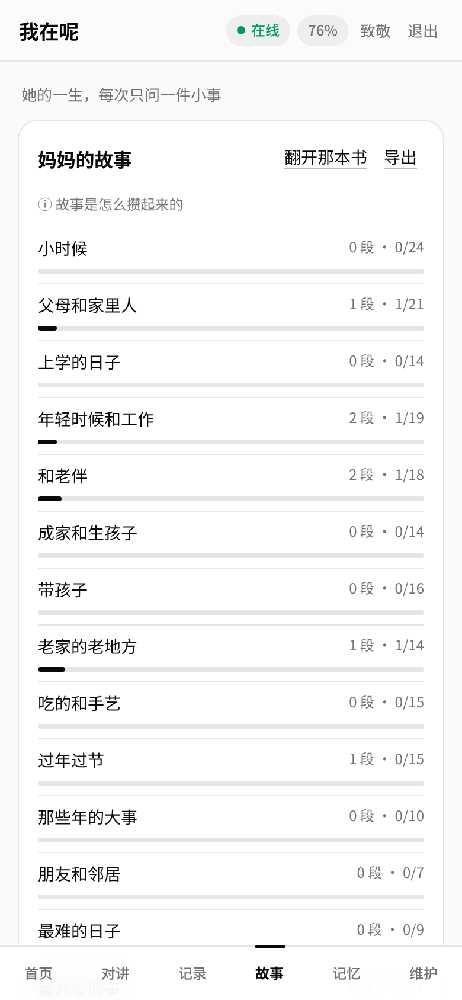
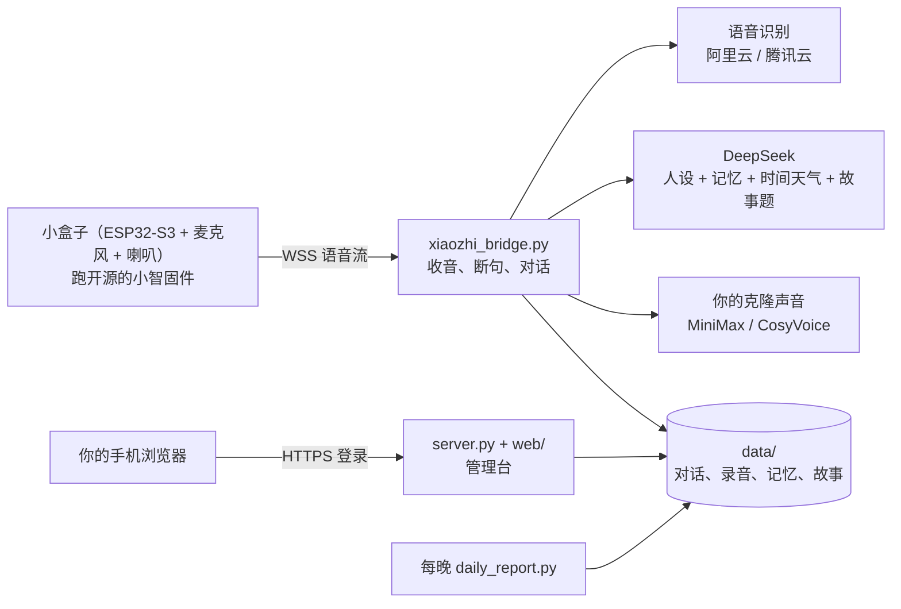

# 我在呢（wozaine）

**她想你的时候，拍一下，就能听到你说：「妈，我在呢。」**

给爸妈的 AI 陪聊小机器。桌上放一个巴掌大的盒子，老人拍一下按钮，就能听到**你的声音**，像你一样陪她聊家常；
你在手机上每天看一份日报，听她说过的每一句话，她讲过的往事被慢慢攒成一本可以翻的书。

这是一个真实在用的项目：一位老人每天都在和它聊天。我们把它清洗干净开源出来，
希望每一个没法天天陪在爸妈身边的人，都能给家里也放一台。

<sub>English: [README.en.md](README.en.md) — *wozaine* ("I'm here") is an open-source, self-hosted AI voice companion for elderly parents. A tiny ESP32-S3 box speaks in your cloned voice, remembers their stories into a book, and sends daily reports to your phone. Any AI coding assistant can deploy it via [AGENTS.md](AGENTS.md).</sub>

<p align="center"></p>
<p align="center"><sub>她讲过的往事，每晚被写成一本可以翻的书——左页是她的原话（点开能听录音），右页是整理的叙述。</sub></p>

<table>
<tr>
<td align="center" width="25%"><br><sub>首页：一眼看家里好不好</sub></td>
<td align="center" width="25%"><br><sub>对讲：按住就是你的声音</sub></td>
<td align="center" width="25%"><br><sub>记录：每一句都能回放原声</sub></td>
<td align="center" width="25%"><br><sub>故事：按人生章节攒下的原话</sub></td>
</tr>
</table>

<p align="center"><sub>截图里的人物和对话都是虚构的演示数据（<code>tools/demo_data.py</code>），不来自任何真实家庭。</sub></p>

## 它能做什么

**老人那边：只有一个按钮**
- **拍一下就聊**：不用唤醒词、不用一直按住。用你克隆的声音、你的说话方式，知道今天几号、什么天气、你最近在忙什么。
- **记得她**：每次聊完自动记下「关于妈妈的事」——家里人、爱吃什么、最近担心什么，下次自然地带上。
- **慢慢问往事**：每次聊天只问一个关于过去的小问题，把她的**原话**连同录音攒起来，每晚整理成一本书。
- **从不突然没声**：网络或服务出问题时，它会用你的声音说「我这边网络有点不好，你等一会儿再拍我」；快没电了会提醒她插上充电线。

**你这边：手机上的管理台**
- **每天一份日报**：今天聊了什么、她的情绪和身体、有什么要跟进、明天可以关心什么。
- **全部对话记录**，每一句都能回放她的原声。
- **对讲**：按住说话，用你**自己真实的声音**直接和她说。
- **调教它**：改人设、改记忆、给故事出题；「错字本」解决口音重、名字总被听错的问题。
- **告警**：设备离线、接口欠费、没电时，发到企业微信 / 飞书 / 钉钉群。
- **家人账号**：兄弟姐妹也能看、能对讲、能出题，改配置的权限只在一个人手里。

## 我们在意的细节

代码不复杂，花时间最多的是这些——每一条都来自老人真实的使用（完整版见 [docs/设计理念.md](docs/设计理念.md)）：

- 每次开口第一句都是「妈，我在呢」，项目的名字就是这么来的。
- 对妈妈说「你」不说「您」；两三句话就收，不肉麻、不像客服；说出来的话像「说」的，不是「写」的。
- **不纠正，不点破**：她记错了、同一个问题问第五遍，都当第一次听到。半夜找它聊天，不说教。
- **不知道就说不知道**：每轮对话都塞进真实的时间、天气和你的日程，绝不编一个像真的一样的答案。
- 不鼓励她打电话（你常常接不到，反而失落），而是说：「你随时想我，就拍一下按钮找我，我随时都在。」
- 故事书里每一段都标着出自她哪一句原话，点开就能听到她的声音；她前后说法不一的地方，照实写。
- 两家语音识别、两家语音合成互为备份；任何一家欠费都会立刻告诉你——老人那边，永远不该是一片沉默。

## 它由什么组成



- **设备**：[小智 AI（xiaozhi-esp32）](https://github.com/78/xiaozhi-esp32) 支持的 ESP32-S3 开发板。我们的固件/ROM 基于征辰 Minicam（不推荐购买，只说明我们用的是它）；别的板子可改配置或让 AI 改编。见 [docs/硬件.md](docs/硬件.md)。
- **服务器**：一台 2 核 4G 的云主机 + 一个域名（HTTPS）。所有对话和录音只存在你自己的服务器上。
- **云服务**：DeepSeek（对话）、阿里云百炼或腾讯云（语音识别）、MiniMax（声音克隆），都按量付费。

## 要花多少、难不难

| | 大约 |
|---|---|
| 开发板 + 外壳 | 一两百元，一次性 |
| 云服务器 + 域名 | 每月几十元 |
| 识别 + 对话 + 合成 | 每月几十元（一位老人每天聊几次；以各家当前价格为准） |
| 动手时间 | 第一次大约半天，大部分时间花在申请账号和克隆声音上 |
| 要会什么 | 会用 AI 编程助手就行；刷固件要装一次 ESP-IDF |

## 快速开始

**最省事的办法：把这个仓库交给你的 AI 编程助手**（Claude Code、Cursor、Codex、通义灵码……），对它说：

> 请阅读这个仓库的 AGENTS.md，帮我把「我在呢」部署到我的服务器上。

它会按 [AGENTS.md](AGENTS.md) 先问清你家的情况，再一步步装好、逐项验收。

**自己动手**：

```bash
git clone https://github.com/runliu2me/wozaine.git && cd wozaine
cp .env.example .env                  # 填 DeepSeek / 识别 / MiniMax 的密钥
cp family.example.json family.json    # 老人和你的名字、所在城市
cp persona.example.md persona.md      # 你平时怎么跟妈妈说话（最重要，慢慢改）
bash deploy/install.sh --domain chat.example.com --email you@example.com
```

然后给设备刷固件、把 OTA 地址指向你的服务器：[firmware/README.md](firmware/README.md)。

## 文档

| 文档 | 写给谁 | 内容 |
|---|---|---|
| [AGENTS.md](AGENTS.md) | AI 助手 | 从零部署的完整步骤、要向用户确认的事、验收清单 |
| [docs/硬件.md](docs/硬件.md) | 准备买东西的人 | 需要什么板子、服务器、域名，大概多少钱 |
| [docs/部署.md](docs/部署.md) | 自己动手的人 | 申请密钥、克隆声音、装服务器、配域名证书、常见问题 |
| [docs/跨平台.md](docs/跨平台.md) | Docker / Windows / macOS 用户 | Docker 一键体验与自托管、Windows/macOS 本地运行与局域网联调 |
| [docs/网络安全.md](docs/网络安全.md) | 要上公网的人 | 端口、三道门、设备口令、nginx 故意做了什么 |
| [SECURITY.md](SECURITY.md) | 安全审稿人 | 必做清单、风险提示、漏洞报告 |
| [firmware/README.md](firmware/README.md) | 刷固件的人 | 用哪个版本的小智固件、怎么打补丁、编译、烧录、设 OTA 地址 |
| [docs/使用说明.md](docs/使用说明.md) | 老人的家人 | 怎么教老人用、管理台每一页、日常维护 |
| [docs/定制指南.md](docs/定制指南.md) | 想改得更像自己的人 | 人设、家庭档案、故事题库、陪爸爸、日历、电话线路、换服务商 |
| [docs/设计理念.md](docs/设计理念.md) | 想知道为什么这么做的人 | 每一个为老人想过的细节 |
| [docs/致谢.md](docs/致谢.md) | 想看全部来源的人 | 开源、思路、硬件、云服务致敬 |

## 常见问题

**不买硬件，能先看看管理台吗？** 能。`python3 tools/demo_data.py demo-data` 生成一套虚构的演示数据，装好依赖后
`COMPANION_DATA_DIR=demo-data venv/bin/python3 server.py`，浏览器打开 http://127.0.0.1:3093 就能看到上面截图里的样子。
想看设备在线、离线、快没电、出故障时首页长什么样，再开一个终端跑 `python3 tools/demo_bridge.py --scene offline`（场景还有 `ok`、`talking`、`charging`、`low`、`alert`），它假装是一台设备。

**不会写代码能做吗？** 能。把仓库交给 AI 编程助手照 AGENTS.md 做；你需要自己完成的是申请账号、录一段声音、买板子。

**能陪爸爸吗？** 能，见 [docs/定制指南.md](docs/定制指南.md)「陪爸爸」一节。

**会拍照吗？** 不会。这个项目没有任何拍照、录像功能：服务端没有照片接口，固件补丁也不初始化摄像头。板子上就算带摄像头，也是关着的。

**老人在国外 / 我在国外能用吗？** 能。设备只要能上网、能连到你的服务器就行；服务器选离老人近、到各家 AI 接口快的地方。

**不想用某家云服务？** 对话模型兼容 OpenAI 接口，识别和合成各是一个函数，见定制指南「换模型或服务商」。

**老人打我手机没接时，能让它接吗？** 可以接云厂商的「语音智能体」，用同一个人设和记忆在电话里陪她，见定制指南「电话线路」（进阶）。

## 使用须知（请务必读）

- **声音只克隆你自己的**，或者明确同意的家人的。用别人的声音冒充别人是违法的。
- **让家里人知道这是 AI。** 它用你的声音说话，但它不是你。我们的经验是，老人知道「这是儿子做的机器，里面是他的声音」之后，反而用得更踏实。
- **不拍照、不录像。** 设备只听声音、只在她拍了它之后才对话；对讲时你能听到她那边的声音，这一点也请让她知道。
- **隐私**：对话录音和文字只存在你自己的服务器 `data/` 目录里；但每句话会发给语音识别和大模型处理，人设和记忆也会作为提示词发给大模型。不愿意交给这些服务商的信息，不要写进人设。
- 它不是医疗设备，不能代替陪伴、看护和紧急呼叫。
- 中国大陆的服务器用域名对外提供网页服务需要 ICP 备案；也可以用香港或海外服务器（见 [docs/硬件.md](docs/硬件.md)）。

## 参与

欢迎分享你家老人用下来发现的「不像」「不体贴」的地方，以及更多板子的适配经验。见 [CONTRIBUTING.md](CONTRIBUTING.md)；安全问题见 [SECURITY.md](SECURITY.md)。

## 致谢

完整致敬页（部署后也可在登录页和管理台打开）：[docs/致谢.md](docs/致谢.md) · 机器清单 [THIRD_PARTY_NOTICES.md](THIRD_PARTY_NOTICES.md)。

- 设备端基于 [78/xiaozhi-esp32](https://github.com/78/xiaozhi-esp32)（MIT）。
- 语音活动检测用 [Silero VAD](https://github.com/snakers4/silero-vad)（MIT）；故事书翻页用 [StPageFlip](https://github.com/Nodlik/StPageFlip)（MIT）。
- 「每次只问一个往事问题、攒成一本书」的思路来自 [StoryWorth](https://www.storyworth.com/)。
- 我们实际使用的板型是征辰 Minicam（说明来源，不是购物推荐）；编译靠 ESP-IDF。
- 对话 / 识别 / 克隆声音分别使用 DeepSeek、阿里云或腾讯云、MiniMax（及 CosyVoice 备份）。

## 许可

[MIT](LICENSE)
