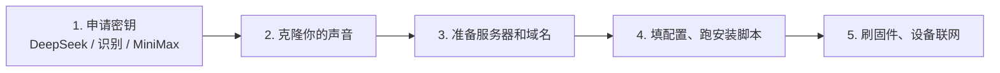

# 部署指南（自己动手版）

整个部署分五步，第一次做大约需要半天（大部分时间花在申请账号和等域名证书上）。
如果你用 AI 编程助手，让它读 [AGENTS.md](../AGENTS.md) 就行，它会照这份文档帮你做。



---

## 1. 申请各家的密钥

| 用途 | 服务 | 必须？ | 去哪儿申请 | 填到 .env |
|---|---|---|---|---|
| 对话大脑 | DeepSeek | 必须 | https://platform.deepseek.com → API Keys，充值几十元 | `DEEPSEEK_API_KEY` |
| 语音识别（主） | 阿里云百炼 qwen3-asr-flash | 和腾讯至少一个 | https://bailian.console.aliyun.com → API-KEY | `DASHSCOPE_API_KEY` |
| 语音识别（备） | 腾讯云一句话识别 | 建议 | https://console.cloud.tencent.com/cam/capi 建密钥，并开通「语音识别」 | `TENCENT_SECRET_ID` `TENCENT_SECRET_KEY` |
| 你的声音 | MiniMax 语音合成 + 声音复刻 | 必须 | https://platform.minimaxi.com → 接口密钥，记下 Group ID | `MINIMAX_API_KEY` `MINIMAX_GROUP_ID` |
| 声音（备） | 阿里云 CosyVoice 声音复刻 | 可选 | 同百炼账号，在控制台做声音复刻 | `COSYVOICE_VOICE_ID` |

经验：
- 识别为什么要两家？任何一家欠费、超时，另一家当场顶上，老人那边不会听不懂。只配一家也能跑。
- 阿里云的识别对带口音的普通话、人名识别得最好；腾讯云的多方言模型反而不如普通话模型。
- 每家都要充一点钱。**欠费是最常见的故障**，所以一定要配告警（第 4 步）。

## 2. 克隆你的声音

1. 用手机录一段你**平时说话**的声音：安静的房间，离手机一拳远，自然地聊 1～3 分钟（比如给妈妈讲讲今天干了什么）。
   不要念稿——念稿克隆出来的声音像播音员，老人一听就不像。
2. 在 MiniMax 开放平台用「快速复刻 / Voice Cloning」上传这段录音，自己起一个 `voice_id`（比如 `xiaoming_v1`）。
   控制台和接口两种方式都可以，按 MiniMax 官方文档操作。
3. 把 `voice_id` 填进 `.env` 的 `MINIMAX_VOICE_ID`。还没弄好的话，先用系统音色 `male-qn-qingse` 把流程跑通。
4. 复刻的音色 **7 天不用会被平台删掉**。安装脚本会装一个每 3 天跑一次的保活任务（`voice-keepalive.timer`），
   保活的音色列表是 `.env` 里的 `MINIMAX_VOICE_IDS`（没填就用 `MINIMAX_VOICE_ID`）。
5. （可选）在阿里云百炼用同一段录音的前 15 秒左右做一个 CosyVoice 复刻，作为 MiniMax 出问题时的备用声音。

可以多复刻几个版本（平静的、活泼的），都写进 `MINIMAX_VOICE_IDS`，部署后在管理台「维护」里切换试听，挑老人最认的那个。

## 3. 准备服务器和域名

上公网前请先读一遍 [网络安全.md](网络安全.md)（端口、三道门、设备口令）。

- **服务器**：一台 Linux 云主机，Ubuntu 22.04 或 24.04，**2 核 4G、20G 硬盘**就够（录音一个月几百 MB）。
  需要有公网 IP，安全组放行 **80 和 443** 端口。
- **域名**：一个子域名就行，比如 `chat.example.com`，A 记录解析到服务器 IP。设备固件要求 HTTPS，
  安装脚本会用 Let's Encrypt 自动申请免费证书。
- **中国大陆的服务器**：80/443 端口对外提供网页服务需要域名 ICP 备案，没备案会被拦。
  办法：用已经备案的域名；或者用香港 / 海外的服务器（延迟多几十毫秒，对聊天影响不大）。
- 服务器上建一个普通用户（不要用 root 跑服务），这个用户要有 sudo 权限。

## 4. 填配置、跑安装脚本

在服务器上，用刚才那个普通用户：

```bash
git clone https://github.com/runliu2me/wozaine.git
cd wozaine
cp .env.example .env && chmod 600 .env
nano .env                       # 填第 1、2 步拿到的密钥
cp family.example.json family.json
nano family.json                # 老人叫什么、你叫什么、各自在哪个城市（报天气用）
cp persona.example.md persona.md
nano persona.md                 # 把【方括号】换成你家的真实情况——这是最影响效果的一步
bash deploy/install.sh --domain chat.example.com --email you@example.com
```

安装脚本会：装系统依赖和 Python 依赖 → 检查 .env → 自动生成设备口令 → 让你设管理台密码 → 跑离线自检 →
装好 systemd 服务并启动 → 配 nginx 和 HTTPS 证书 → 健康检查。最后打印出管理台地址和设备 OTA 地址。

**告警**（强烈建议）：在 `.env` 里配 `ALERT_WEBHOOK_URL`。最简单的是建一个企业微信群（或飞书 / 钉钉群），
加一个「群机器人」，把它的 webhook 地址填进去，`ALERT_WEBHOOK_KIND` 填 `wecom` / `feishu` / `dingtalk`。
设备离线超过 2 小时、识别或合成欠费、DeepSeek 余额低、设备没电，都会发到群里。

改了 `.env`、`family.json` 或代码后，重新跑一遍 `bash deploy/install.sh` 就会更新并重启；
只改 `persona.md` 可以直接在管理台「维护」里改，保存即生效。

### 服务一览

| 服务 | 端口（只监听本机） | 作用 |
|---|---|---|
| `xiaozhi-bridge.service` | 3096 OTA、3097 设备 WebSocket、3098 对讲 | 设备连的就是它：收音、识别、对话、合成 |
| `companion.service` | 3093 | 管理台网页和接口 |
| `companion-realtime.service` | 3095 | 管理台里「通话」页的全双工语音（浏览器测试用） |
| `daily-report.timer` | — | 每晚 23:40：日报、整理记忆、摘故事、出新题、写书、错字本回改 |
| `device-monitor.timer` | — | 每 15 分钟：设备离线、服务故障、余额告警 |
| `voice-keepalive.timer` | — | 每 3 天：复刻音色保活 |
| `schedule-sync.timer` | — | 每小时同步你的日历（可选，配了 `SCHEDULE_ICS_URL` 才启用） |

看日志：`journalctl -u xiaozhi-bridge -f`。数据全在仓库目录下的 `data/`，**备份这个目录就是备份全部**。

## 5. 刷固件、设备联网

见 [firmware/README.md](../firmware/README.md)。要点：
1. 用上游小智固件（推荐打上本仓库的补丁），把 OTA 地址设成 `https://你的域名/xiaozhi/ota/`。
2. 设备第一次开机会开一个 Wi-Fi 热点，手机连上去配家里的 Wi-Fi。
3. 连上后在 `journalctl -u xiaozhi-bridge` 里能看到它的 MAC 地址。把 MAC 填进 `.env` 的
   `XIAOZHI_ALLOWED_DEVICE_IDS` 和 `XIAOZHI_ELDER_DEVICE_ID`，确认能正常对话后把 `XIAOZHI_REQUIRE_DEVICE_TOKEN` 改成 `1`，
   再跑一次安装脚本。这样别人就算知道你的域名，也连不上、花不了你的钱。
   注意：在完成这一步之前，任何知道你域名的人都能连上来消耗你的接口额度，所以设备一连上就做。
   MAC 白名单本身可以伪造，真正起作用的是 `XIAOZHI_REQUIRE_DEVICE_TOKEN=1`（口令只在 OTA 时下发给白名单里的设备）。
   板子喇叭是 24k 的（看板子 config.h 里的 `AUDIO_OUTPUT_SAMPLE_RATE`，我们用的 Minicam 是 24k），顺便填 `XIAOZHI_TX_SAMPLE_RATES=<MAC>=24000`，音质更好。

## 常见问题

| 现象 | 多半是 | 怎么查 |
|---|---|---|
| 设备说「网络有点不好，你等一会儿再拍我」 | 识别 / DeepSeek / MiniMax 某一家欠费或密钥错 | `journalctl -u xiaozhi-bridge -n 200`，管理台「维护 → 连通性」 |
| 设备一直连不上 | OTA 地址错、证书没申请成功、设备不在白名单 | 浏览器打开 `https://你的域名/xiaozhi/ota/` 应该有响应；看 bridge 日志里有没有 `rejected` |
| 名字总被听错 | 正常，口音重的老人尤其多 | `family.json` 的 `asr_context` 写上家里人名；用一两周后在「错字本」里确认 |
| 声音不像 | 录音是念稿的、或有杂音 | 重录一段自然聊天的；多复刻几个版本对比 |
| 证书申请失败 | 域名没解析好、80 端口没放行、大陆服务器没备案 | 修好后 `sudo certbot --nginx -d 你的域名` |
| 管理台改配置后「重启服务」没反应 | sudoers 没装好 | `sudo -l` 里应能看到 `/usr/local/sbin/wozaine-restart` |
